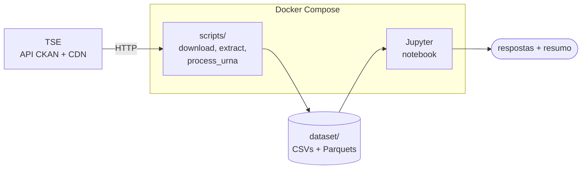
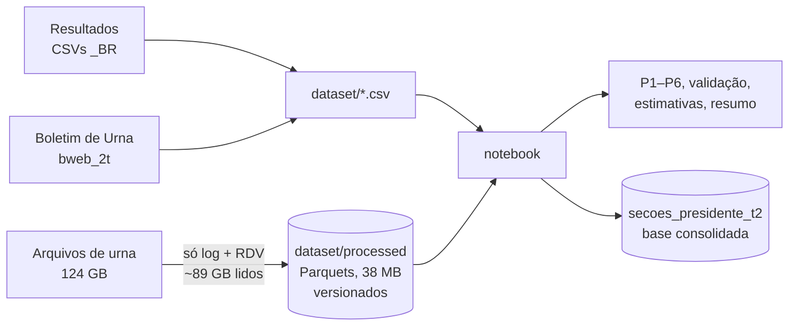
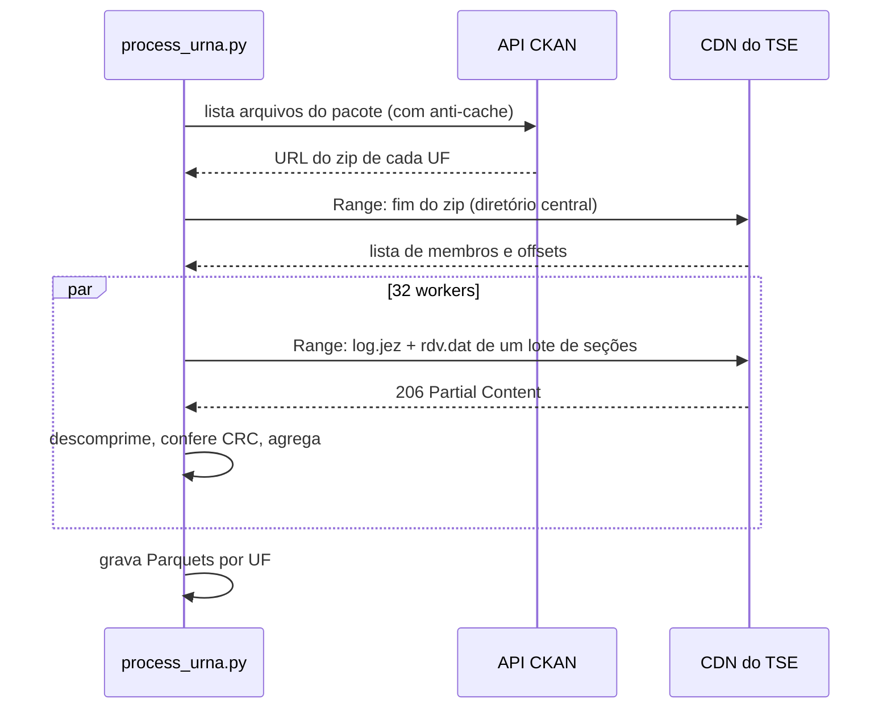

# Eleições 2026: 2º turno para Presidente

[](LICENSE)
[](https://www.python.org/)
[](https://pandas.pydata.org/)
[](https://jupyter.org/)
[](docker-compose.yml)
[](https://dadosabertos.tse.jus.br)
[](#escopo)
[](#validação)

Análise reprodutível e aberta do **2º turno da eleição presidencial de 25/10/2026**, feita com os dados abertos do TSE. Ela vai além do resultado oficial: a partir do **log** e do **RDV** de cada uma das ~500 mil urnas, mede **a que horas** as pessoas votaram, **quantas votaram sem biometria** e **quais números digitaram ao anular o voto**.

> **Quer só os números?** Veja [Resultados](#resultados).
> **Quer analisar?** Os dados já processados estão no repositório: `git clone` e [abra o notebook](#começo-rápido). Não é preciso baixar nada.

## Sumário

- [Resultados](#resultados)
- [Interpretações](#interpretações)
- [Limitações e lacunas](#limitações-e-lacunas)
- [Começo rápido](#começo-rápido)
- [Como funciona](#como-funciona)
- [Reproduzir do zero](#reproduzir-do-zero)
- [Dados versionados](#dados-versionados)
- [Estrutura do repositório](#estrutura-do-repositório)
- [Licença](#licença)

## Escopo

O notebook [`notebooks/analise_eleicoes_2026.ipynb`](notebooks/analise_eleicoes_2026.ipynb) responde seis perguntas sobre o **2º turno, cargo Presidente**:

1. Quantas pessoas votaram entre 17h e 19h (horário de Brasília)?
2. Qual foi a proporção desses votos?
3. Quantas pessoas votaram sem biometria?
4. Qual foi a proporção dos votos sem biometria?
5. Qual foi a proporção dos votos (candidatos, brancos, nulos), no Brasil e por UF?
6. Quais números foram mais digitados ao anular o voto?

O 1º turno e os demais cargos estão fora do escopo.

## Resultados

Todos os números vêm do notebook executado sobre os dados completos (499.205 seções, 28 UFs incluindo o exterior).

### Respostas

| # | Pergunta | Resposta |
|---|---|---|
| 1 | Votos entre 17h e 19h (Brasília) | **34.736** pessoas |
| 2 | Proporção desses votos | **0,027%** dos 128.235.225 votos registrados nos logs |
| 3 | Votos sem biometria | **16.268.923** eleitores votaram sem ser liberados pela própria digital. Desses, **8.632.488** tinham biometria cadastrada e não foram reconhecidos (BU). |
| 4 | Proporção sem biometria | **12,69%** dos votos (6,73% só entre quem tinha biometria cadastrada). Maior: **ES, 27,37%**. Menor: **RR, 7,05%**. |
| 5 | Proporção dos votos | Ver tabela abaixo. Comparecimento de **80,78%** dos aptos, abstenção de **19,22%**. Maior % de nulos: **TO, 3,75%**. |
| 6 | Números mais digitados ao anular | **00** (54,5% dos nulos), **11** (6,0%), **14** (5,3%), **12** (3,6%), **99** (2,9%) |

### Composição dos votos (Brasil)

| Opção | Votos | % do total | % dos válidos |
|---|---:|---:|---:|
| **Lula** (13, PT) | 64.256.232 | 50,11% | **51,79%** |
| **Flávio Bolsonaro** (22, PL) | 59.826.041 | 46,65% | **48,21%** |
| Brancos | 1.430.496 | 1,12% | — |
| Nulos | 2.723.305 | 2,12% | — |
| **Total** | **128.236.074** | 100% | |

Os nulos somam os 2.722.696 votos com número digitado inválido e 609 nulos por suspensão da votação.

### Lula × Flávio Bolsonaro: onde cada um venceu

| | Lula | Flávio Bolsonaro |
|---|---:|---:|
| UFs vencidas | 13 | 14 |
| Municípios vencidos | 2.875 | 2.695 (+1 empate) |
| Seções vencidas | 250.935 | 246.115 (+2.155 empates) |

| Região | Lula (% válidos) | Flávio (% válidos) | Diferença (votos) |
|---|---:|---:|---:|
| Nordeste | **69,4%** | 30,6% | Lula +13,65 mi |
| Exterior | **53,9%** | 46,1% | Lula +29 mil |
| Norte | **50,01%** | 49,99% | Lula +1.079 |
| Sudeste | 47,2% | **52,8%** | Flávio +2,81 mi |
| Centro-Oeste | 40,0% | **60,0%** | Flávio +1,87 mi |
| Sul | 37,4% | **62,6%** | Flávio +4,58 mi |

- **Maiores vantagens de Lula:** PI (75,9% dos válidos), BA (71,3%), MA (69,5%); entre cidades, São Paulo (+766 mil votos) e Salvador (+732 mil).
- **Maiores vantagens de Flávio:** RR (72,5% dos válidos), RO (69,6%), SC (69,4%); entre cidades, Curitiba (+277 mil) e Goiânia (+204 mil).
- **MG** ficou praticamente empatado: 50,43% dos válidos para Lula.

### Em quem votou quem votou tarde ou sem biometria?

**Não é possível contar.** O voto é secreto: o log sabe *quando* e *como* cada eleitor foi liberado, mas não *em quem* votou, e o RDV guarda os votos embaralhados, sem hora nem eleitor. O notebook faz uma **estimativa estatística** no nível da seção (inferência ecológica):

| Grupo | Lula | Flávio | Brancos | Nulos | Confiável? |
|---|---:|---:|---:|---:|---|
| Todos (resultado contado) | 50,1% | 46,7% | 1,1% | 2,1% | contagem oficial |
| Sem biometria (estimativa) | ~52,7% | ~44,2% | ~1,1% | ~2,0% | ✅ coerente entre dois métodos |
| Depois das 17h | — | — | — | — | ❌ poucos votos (média de 0,07 por seção), o método falha |

Para quem votou depois das 17h, o único dado disponível descreve **o lugar**, não as pessoas: as seções onde eles votaram deram 52,5% a Lula e 44,0% a Flávio.

### Validação

Os dados derivados do log e do RDV foram conferidos, seção a seção, com o Boletim de Urna oficial:

| Checagem | Seções que conferem |
|---|---:|
| Brancos do RDV = BU | **100%** (499.205) |
| Nulos do RDV = BU | **100%** (499.205) |
| Votos no log = comparecimento do BU | **99,993%** (499.170) |
| Candidatos + brancos + nulos = total oficial | Brasil e todas as UFs |
| Soma das seções do BU = total oficial de cada candidato | exata |

## Interpretações

- **Votar depois das 17h é raro.** As urnas fecham às 17h de Brasília, e só vota depois quem já estava na fila. Foram 34.736 pessoas, cerca de 1 em cada 3.700. As maiores proporções estão em RO, DF, RR e AM (~0,05%), e as menores no Sul (SC, 0,010%). O exterior aparece no topo (0,11%), mas ali o horário é o local de cada país e não é comparável.
- **Votar sem biometria não é exceção.** Cerca de 1 em cada 8 eleitores votou sem a própria digital. Metade desses tinha biometria cadastrada e não foi reconhecida (6,73%). A outra metade inclui quem não tem biometria cadastrada e os eleitores do exterior, onde não há habilitação biométrica (380 mil). O ES é um ponto fora da curva (27,4%, mais que o dobro da média) e merece investigação, por exemplo quanto à cobertura do cadastro biométrico.
- **O "00" domina os nulos.** Mais da metade de quem anulou digitou 00, o jeito mais direto de anular. Vários dos números seguintes (11, 12, 14, 15, 31, 55) parecem números de partidos. Uma hipótese, não verificada aqui, é que sejam eleitores digitando o número de quem não está no 2º turno.
- **O país dividido em geografia.** Lula venceu por 4,43 milhões de votos (3,58 pontos dos válidos) com uma vantagem enorme no Nordeste (+13,7 mi), maior que a soma das vantagens de Flávio no Sul, Sudeste e Centro-Oeste (+9,3 mi). O Norte terminou praticamente empatado.
- **Sem biometria, levemente mais Lula.** A estimativa indica um grupo cerca de 2 pontos mais favorável a Lula que a média. É inferência estatística, sujeita à *falácia ecológica*, e não deve ser lida como contagem.

## Limitações e lacunas

| Lacuna | Impacto | Detalhe |
|---|---|---|
| **28 seções sem log** e **7 com log divergente** do BU | 849 votos (0,0007%) fora de P1–P4 | P5 usa os totais oficiais e não é afetado |
| **Voto × horário/biometria não se liga** | P5 por grupo só pode ser estimada | Por desenho do sistema (sigilo do voto); a menor unidade de cruzamento é a seção |
| **Voto depois das 17h sem estimativa** | Não há resposta confiável sobre em quem votaram | Poucos votos para inferência ecológica |
| **Fuso inferido** | Horários convertidos para Brasília | Pela hora de abertura da urna (moda por município). Captura AC, oeste do AM, MS, MT, RO, RR e Fernando de Noronha. **Exterior em hora local.** |
| **"Sem biometria" medido pelo log** | Não há fonte oficial para conferir a contagem total | Segue a sequência de mensagens do log ([máquina de estados](docs/fluxo-de-dados.md#máquina-de-estados-do-log)). O BU só tem o subconjunto "tinha biometria e não foi reconhecido". |
| **Especificação do RDV de terceiros** | Decodificação dos nulos | Obtida do [DataUrnas-BR](https://github.com/alissonlinneker/DataUrnas-BR/blob/main/spec/v2/rdv.asn1) porque o site do TSE bloqueia download automatizado. Validada: brancos e nulos conferem com o BU em 100% das seções. |
| **Dados podem mudar** | Retotalizações | BU e arquivos de urna de 26/10/2026; CSVs de resultado gerados em 30/10/2026. Para atualizar, [reproduza do zero](#reproduzir-do-zero). |
| **Escopo** | — | Só 2º turno e Presidente |

## Começo rápido

Pré-requisito: [Docker](https://docs.docker.com/get-docker/) com Compose. Os dados processados (~38 MB) já estão no repositório.

```bash
git clone <este repositório> && cd eleicoes-2026
cp .env.example .env
sed -i "s/HOST_UID=.*/HOST_UID=$(id -u)/; s/HOST_GID=.*/HOST_GID=$(id -g)/" .env
docker compose up --build
```

Abra http://127.0.0.1:8888 e depois `notebooks/analise_eleicoes_2026.ipynb`. O resumo com as respostas está no final.

Para análises novas, comece pela base consolidada, que tem uma linha por seção com votos por candidato, horário e biometria:

```python
import pandas as pd

secoes = pd.read_parquet("dataset/processed/secoes_presidente_t2.parquet")
secoes.groupby("regiao")[["lula", "flavio_bolsonaro", "votos_sem_biometria"]].sum()
```

## Como funciona

Os diagramas abaixo são uma visão de alto nível. Os detalhes estão em [`docs/`](docs/):

| Documento | Conteúdo |
|---|---|
| [Arquitetura](docs/arquitetura.md) | contêiner, módulos, processamento paralelo e armazenamento |
| [Fluxo dos dados](docs/fluxo-de-dados.md) | fontes, processamento de cada seção, máquina de estados do log, análise e validações |
| [Requisições](docs/requisicoes.md) | diagramas de sequência da API CKAN, do download do BU e da leitura seletiva via HTTP Range; tratamento de falhas |

### Arquitetura



### Fluxo dos dados



### Requisições: leitura seletiva



### De onde vem cada resposta

Todas as fontes são do [Portal de Dados Abertos do TSE](https://dadosabertos.tse.jus.br).

| Pergunta | Dado | Pacote | Volume lido |
|---|---|---|---|
| 1, 2 | Log de cada urna: hora de cada voto | [`resultados-2026-arquivos-transmitidos-para-totalizacao`](https://dadosabertos.tse.jus.br/dataset/resultados-2026-arquivos-transmitidos-para-totalizacao) | ~89 GB |
| 3, 4 | Log de cada urna: tipo de habilitação | idem (mesma leitura) | — |
| 3, 4 | Boletim de Urna: `QT_ELEI_BIOM_SEM_HABILITACAO` | [`resultados-2026-boletim-de-urna`](https://dadosabertos.tse.jus.br/dataset/resultados-2026-boletim-de-urna) | 0,14 GB |
| 5 | `detalhe_votacao_munzona_2026_BR.csv`, `votacao_candidato_munzona_2026_BR.csv` + BU | [`resultados-2026`](https://dadosabertos.tse.jus.br/dataset/resultados-2026) | ~45 MB |
| 6 | RDV (Registro Digital do Voto) de cada urna | igual a 1 e 2 (mesma leitura) | ~0,1 GB |

Os CSVs de resultado não têm a hora dos votos nem a biometria, e agregam todos os nulos como `96`. Por isso P1–P4 e P6 dependem dos arquivos de cada urna:

- o **log** registra cada eleitor, com hora e tipo de habilitação;
- o **RDV** guarda cada voto como foi digitado.

**Leitura seletiva:** os zips de urna somam 124 GB, mas o log ocupa ~72% e o RDV ~0,1%. O resto, assinaturas (~25%) e BU e imagem do BU (~2,4%), não interessa. Como o CDN do TSE aceita requisições HTTP `Range`, o [`scripts/remote_zip.py`](scripts/remote_zip.py) faz três coisas:

1. lê só o índice de cada zip;
2. busca apenas o log e o RDV de cada seção;
3. descomprime em memória e confere o CRC.

Nenhum zip é gravado em disco.

## Reproduzir do zero

Para conferir os dados versionados ou regerá-los a partir do TSE.

| Recurso | Uso |
|---|---|
| Rede | ~90 GB |
| Disco | ~1,1 GB (BU: 0,14 GB em zip + 0,9 GB em CSV; resultados: 45 MB; Parquets: 38 MB) |
| Tempo | ~30–45 min com ~60 MB/s de rede; o gargalo é a rede |

```bash
cp .env.example .env
sed -i "s/HOST_UID=.*/HOST_UID=$(id -u)/; s/HOST_GID=.*/HOST_GID=$(id -g)/" .env
docker compose build

# 1. Extrai do zip remoto só os CSVs _BR de resultado e baixa o BU do 2º turno (confere SHA-512)
docker compose run --rm jupyter python scripts/download.py

# 2. Extrai os CSVs do BU
docker compose run --rm jupyter python scripts/extract.py

# 3. Lê log + RDV de cada seção direto do CDN, UF por UF (para testar: --ufs AC)
docker compose run --rm jupyter python scripts/process_urna.py

# 4. Executa o notebook (ou abra o Jupyter com: docker compose up)
docker compose run --rm jupyter jupyter nbconvert --to notebook --execute --inplace notebooks/analise_eleicoes_2026.ipynb
```

- **Idempotência:** o que já foi baixado ou processado é pulado. Para regerar tudo, apague antes `dataset/processed/*.parquet`.
- **Retomada:** o `process_urna.py` retoma por UF e aceita `--ufs AC SP ...` e `--workers N` (padrão 32).
- **Atualização automática:** o notebook regera os Parquets de BU e de resultados quando encontra CSVs mais novos que eles.

## Dados versionados

Todos ficam em `dataset/processed/` (~38 MB, Parquet).

**Origem:**
- BU e arquivos de urna publicados pelo TSE em 26/10/2026 (zips `bweb_2t_*_261020260742`);
- CSVs de resultado gerados em 30/10/2026.

| Arquivo | Conteúdo | Gerado por |
|---|---|---|
| **`secoes_presidente_t2.parquet`** | **Base consolidada**, uma linha por seção: município, região, local de votação, aptos, comparecimento, `lula`, `flavio_bolsonaro`, brancos, nulos, `votos_17h_19h`, `votos_sem_biometria`, totais do RDV e fuso | notebook |
| `bu_secoes_presidente_t2.parquet` | Só a parte do Boletim de Urna da base acima | notebook |
| `munzona_presidente_t2.parquet` | Totais oficiais por município e zona: aptos, comparecimento, brancos, nulos etc. | notebook |
| `candidato_munzona_presidente_t2.parquet` | Votos de cada candidato por município e zona | notebook |
| `log_hora_t2_<UF>.parquet` | Por seção e **hora local**: `votos`, `votos_biometria`, `habilitados`, `habilitados_biometria` | `process_urna.py` |
| `log_secoes_t2_<UF>.parquet` | Por seção: hora em que a urna ficou pronta, nº de urnas no log, erros | `process_urna.py` |
| `rdv_tipos_t2_<UF>.parquet` | Votos para Presidente por seção e tipo (nominal, branco, nulo…) | `process_urna.py` |
| `rdv_nulos_t2_<UF>.parquet` | Números digitados nos votos nulos, por seção | `process_urna.py` |

**Convenções dos CSVs do TSE**, caso você use os originais: Latin-1, separador `;`. `#NULO` e `-1` significam "em branco"; `#NE` e `-3`, "não existia naquele ano". O [`scripts/tse_io.py`](scripts/tse_io.py) já trata isso.

## Estrutura do repositório

```
scripts/
  datasets.py         pacotes CKAN, turno, caminhos, UFs
  download.py         CSVs de resultado (leitura remota) e BU (download retomável + SHA-512)
  extract.py          extrai os CSVs do BU
  remote_zip.py       leitura seletiva de zip remoto via HTTP Range
  process_urna.py     log + RDV por seção -> dataset/processed/*.parquet
  tse_io.py           leitura padronizada dos CSVs do TSE
  spec/rdv.asn1       especificação ASN.1 do RDV
notebooks/
  analise_eleicoes_2026.ipynb
docs/
  arquitetura.md      contêiner, módulos, paralelismo, armazenamento
  fluxo-de-dados.md   das fontes às respostas
  requisicoes.md      requisições ao TSE e tratamento de falhas
dataset/
  processed/          Parquets versionados
  ...                 downloads (não versionados)
```

## Licença

O código está sob a licença [MIT](LICENSE).

Os dados de origem são públicos, do [Portal de Dados Abertos do TSE](https://dadosabertos.tse.jus.br). Os arquivos em `dataset/processed/` derivam deles: ao reutilizá-los, cite o TSE como fonte original.
