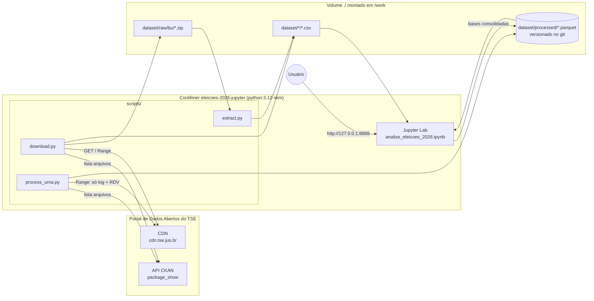
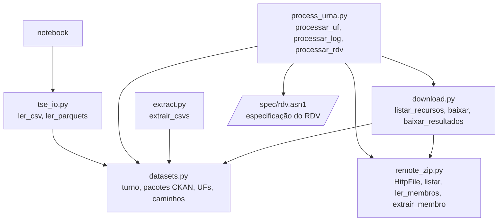
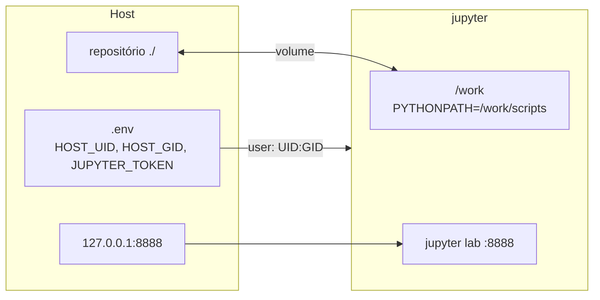
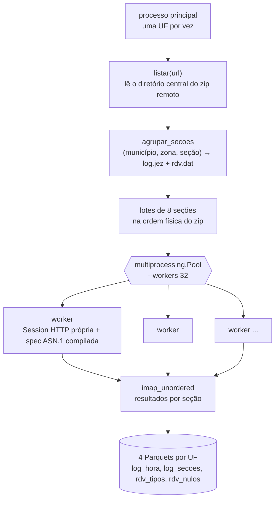

# Arquitetura

O projeto tem três camadas, todas rodando no mesmo contêiner Docker:

1. **Aquisição:** `scripts/download.py` e `scripts/extract.py` baixam o que é pequeno, ou seja, os CSVs de resultado e o Boletim de Urna.
2. **Processamento:** `scripts/process_urna.py` lê **remotamente**, por HTTP Range, só o log e o RDV de cada seção, dentro dos zips de urna de 124 GB. Grava agregados em Parquet.
3. **Análise:** o notebook `notebooks/analise_eleicoes_2026.ipynb` usa pandas sobre os Parquets e os CSVs, responde às perguntas e gera as bases consolidadas.

Os Parquets de `dataset/processed/` (~38 MB) são versionados no git. Com eles, a camada de análise roda sozinha, sem as camadas 1 e 2.

Veja também:
- [Fluxo dos dados](fluxo-de-dados.md): de onde vem cada dado e como vira resposta.
- [Requisições](requisicoes.md): como os scripts conversam com o TSE (diagramas de sequência).

## Visão geral

## Módulos e dependências

| Módulo | Responsabilidade |
|---|---|
| `datasets.py` | Configuração única: `TURNO = 2`, data do turno, ids dos pacotes CKAN, membros a extrair dos zips de resultado, lista de UFs, caminhos de `dataset/`. |
| `remote_zip.py` | Leitura de zip remoto via HTTP Range: índice (diretório central), membros agrupados em poucas requisições, descompressão em memória e conferência de CRC. |
| `download.py` | Lista recursos na API CKAN (com anti-cache), extrai os CSVs `_BR` de resultado do zip remoto e baixa os zips do BU com retomada e SHA-512. |
| `extract.py` | Extrai só os `.csv` dos zips do BU. |
| `process_urna.py` | Para cada UF, lê log + RDV de ~500 mil seções em paralelo e grava os agregados por seção em Parquet. |
| `tse_io.py` | Leitura padronizada: CSVs do TSE (Latin-1, `;`, sentinelas `#NULO`/`#NE`) e Parquets processados. |
| `spec/rdv.asn1` | Especificação ASN.1 do Registro Digital do Voto, usada pelo `asn1tools` para decodificar o `rdv.dat`. |

## Contêiner

- **Imagem:** `python:3.12-slim` com as versões fixadas em `requirements.txt`: pandas, pyarrow, matplotlib, requests, asn1tools, py7zr, tqdm e jupyterlab.
- **Usuário:** o contêiner roda com o UID e o GID do host, lidos do `.env`. Assim, o que ele grava em `dataset/` pertence ao seu usuário.
- **Imports:** `PYTHONPATH=/work/scripts` faz os scripts e o notebook importarem os módulos (`from tse_io import ...`) sem precisar instalar pacote.
- **Rede:** a porta é publicada só em `127.0.0.1`, e o Jupyter exige o token do `.env` quando ele está definido.

## Processamento paralelo (`process_urna.py`)

Decisões de projeto:

- **Leitura seletiva em vez de download:** o log ocupa ~72% dos zips de urna e o RDV ~0,1%. O resto, assinaturas (~25%) e imagem e arquivo do BU (~2,4%), nunca é transferido. Nada é gravado em disco além dos agregados.
- **Lotes na ordem do zip:** seções vizinhas no zip ficam no mesmo lote. Assim, membros próximos (o log e o RDV de uma seção, ou de seções consecutivas) saem numa **única** requisição Range sempre que o intervalo entre eles for de até 16 KB (`gap_max`).
- **Paralelismo por processos:** o gargalo é a rede, cerca de 50–76 MB/s medidos. Processos evitam o GIL na descompressão e na decodificação ASN.1, e cada um tem sua própria `requests.Session`, com retry e backoff.
- **Idempotência:** cada UF só é processada se algum dos seus 4 Parquets estiver faltando. Se a execução for interrompida, ela retoma da UF seguinte.
- **Falhas isoladas:** um erro de download ou de decodificação marca só as seções afetadas (coluna `erro` em `log_secoes`), sem derrubar a UF.

## Armazenamento

| Caminho | Conteúdo | Versionado | Tamanho |
|---|---|---|---|
| `dataset/raw/bu/` | zips `bweb_2t_*` do BU | não | 0,14 GB |
| `dataset/bweb_2t_*/` | CSVs do BU | não | 0,9 GB |
| `dataset/detalhe_votacao_munzona_2026/`, `dataset/votacao_candidato_munzona_2026/` | CSVs `_BR` de resultado | não | 45 MB |
| `dataset/processed/` | Parquets do `process_urna.py` e do notebook | **sim** | ~38 MB |

O conteúdo de cada Parquet está descrito no [README](../README.md#dados-versionados).
