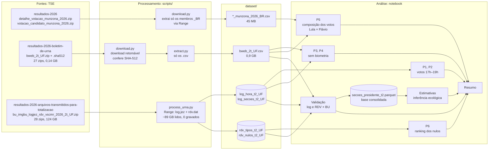
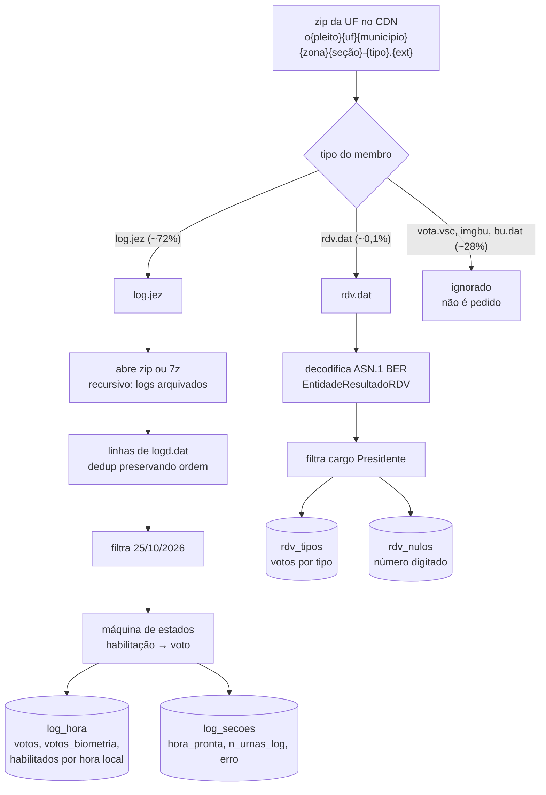
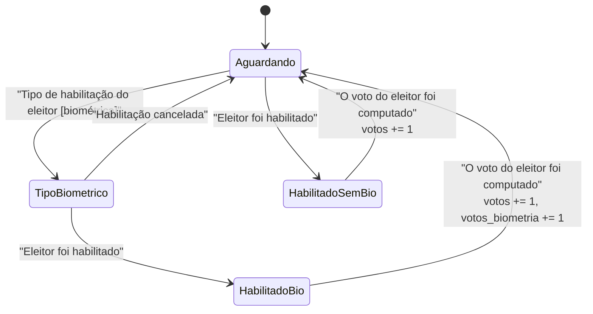
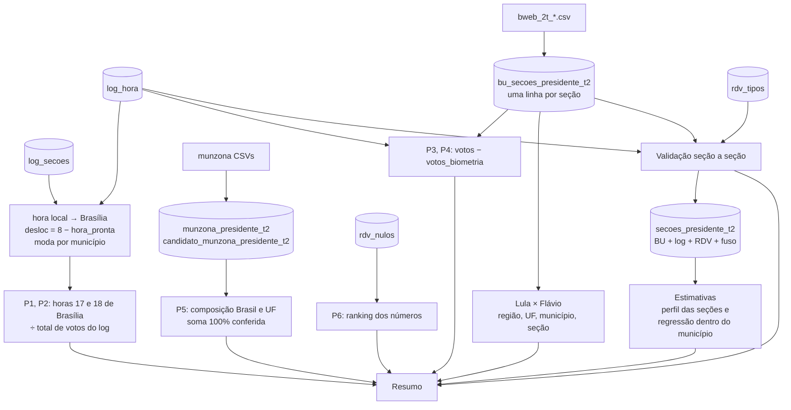
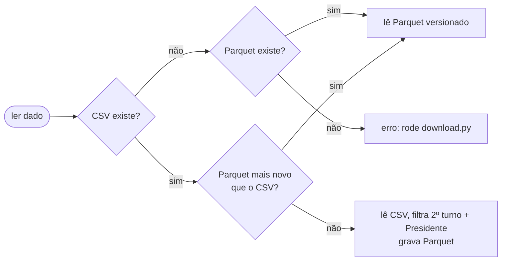

# Fluxo dos dados

Este documento mostra o caminho de cada dado: de onde vem (pacotes do TSE), como é processado (scripts) e como é analisado (notebook) até virar resposta.

Veja também a [arquitetura](arquitetura.md) e as [requisições](requisicoes.md).

## Visão completa

`UF` nos nomes de arquivo representa a sigla da UF (`AC`, `SP`… e `ZZ` para o exterior).

## Que dado responde cada pergunta

| Pergunta | Dado | Por que esse dado |
|---|---|---|
| 1, 2. Votos entre 17h e 19h | log da urna | É o único que tem a hora de cada voto. Os CSVs de resultado e o BU não têm hora. |
| 3, 4. Votos sem biometria | log da urna + BU | O log mostra o tipo de habilitação de cada eleitor. O BU tem `QT_ELEI_BIOM_SEM_HABILITACAO`: quem tinha biometria cadastrada e não foi reconhecido. |
| 5. Composição dos votos | CSVs `munzona` + BU | Os CSVs têm os totais oficiais por município e zona. O BU tem o mesmo dado por seção, usado em Lula × Flávio. |
| 6. Números digitados nos nulos | RDV | Os CSVs agregam todo nulo como `96`. Só o RDV guarda o número digitado. |

## Processamento de uma seção

Cada seção do zip de urna tem cinco arquivos. O `process_urna.py` busca só dois deles.

### Máquina de estados do log

O log tem uma linha por evento, sem identificar o eleitor. O tipo de habilitação é registrado **antes** da habilitação, e cada voto computado herda o tipo da última habilitação.

A mensagem "Urna pronta para receber votos" marca a abertura, que é às 8h de Brasília. O notebook usa essa hora para inferir o fuso de cada município.

## Análise no notebook

### Caches em Parquet

Quando não encontra os CSVs, o notebook lê os Parquets versionados. Quando os CSVs existem e são mais novos que o Parquet, ele regera o Parquet.

## Validações embutidas

| Checagem | Onde | Resultado (2º turno) |
|---|---|---|
| CRC32 de cada membro lido via Range | `remote_zip.py` | toda leitura |
| SHA-512 dos zips do BU | `download.py` | 27 de 27 |
| Candidatos + brancos + nulos + demais = `QT_VOTOS` | notebook, P5 | Brasil e todas as UFs |
| Soma do BU por seção = total oficial de cada candidato | notebook, Lula × Flávio | exata |
| Brancos e nulos do RDV = BU | notebook, Validação | 100% das 499.205 seções |
| Votos do log = comparecimento do BU | notebook, Validação | 99,993% (28 seções sem log, 7 divergentes) |
