# Relatório: 2º turno da eleição presidencial de 2026

- **Eleição:** 25/10/2026, cargo Presidente
- **Base:** 499.205 seções eleitorais (27 UFs e exterior), 158.744.977 eleitores aptos e 128.236.074 votos
- **Fontes:** dados abertos do TSE: resultados oficiais, Boletim de Urna, e o log e o Registro Digital do Voto (RDV) de cada urna

---

## 1. Perguntas e respostas

| # | Pergunta | Resposta |
|---|---|---|
| 1 | Quantas pessoas votaram entre 17h e 19h? | **34.736 pessoas** (horário de Brasília) |
| 2 | Qual foi a proporção desses votos? | **0,027%** dos votos, cerca de 1 em cada 3.700 eleitores |
| 3 | Quantas pessoas votaram sem biometria? | **16.268.923 pessoas** votaram sem ser liberadas pela própria digital. Delas, **8.632.488** tinham biometria cadastrada e não foram reconhecidas. |
| 4 | Qual foi a proporção dos votos sem biometria? | **12,69%** dos votos. Entre quem tinha biometria cadastrada e não foi reconhecido: **6,73%**. |
| 5 | Qual foi a proporção dos votos? | **Lula 50,11%**, **Flávio Bolsonaro 46,65%**, brancos 1,12%, nulos 2,12% do total. Nos válidos: **Lula 51,79% × 48,21%**. Comparecimento de 80,78%. |
| 6 | Quais números foram mais digitados para anular? | **00** (54,5% dos nulos), **11** (6,0%), **14** (5,3%), **12** (3,6%), **99** (2,9%) |
| — | Em quem votou quem votou tarde ou sem biometria? | **Não é possível contar**, porque o voto é secreto. Estimativa para quem votou sem biometria: ~52,7% Lula e ~44,2% Flávio. Para quem votou depois das 17h não há estimativa confiável. |

---

## 2. Resultado geral

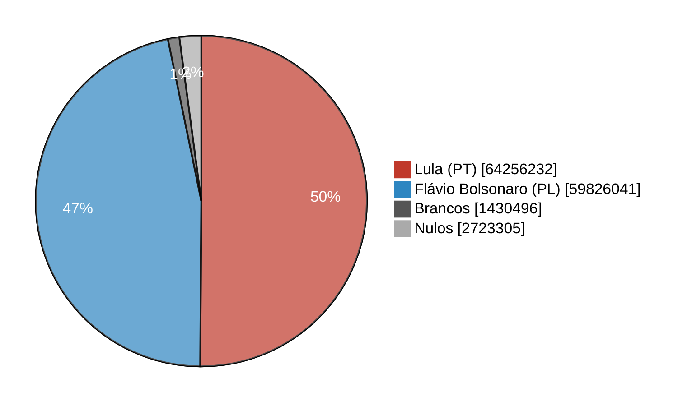

| Opção | Votos | % do total | % dos válidos |
|---|---:|---:|---:|
| Lula (13, PT) | 64.256.232 | 50,11% | **51,79%** |
| Flávio Bolsonaro (22, PL) | 59.826.041 | 46,65% | **48,21%** |
| Brancos | 1.430.496 | 1,12% | — |
| Nulos | 2.723.305 | 2,12% | — |
| **Total de votos** | **128.236.074** | 100% | |
| Abstenção | 30.508.903 | 19,22% dos aptos | |

Lula venceu por **4.430.191 votos**, uma diferença de 3,58 pontos nos válidos.

| Onde cada um venceu | Lula | Flávio Bolsonaro | Empate |
|---|---:|---:|---:|
| UFs (sem o exterior) | 13 | 14 | — |
| Municípios (sem o exterior) | 2.875 | 2.695 | 1 |
| Seções | 250.935 | 246.115 | 2.155 |

---

## 3. Lula × Flávio Bolsonaro: comparação por região e UF

### Por região

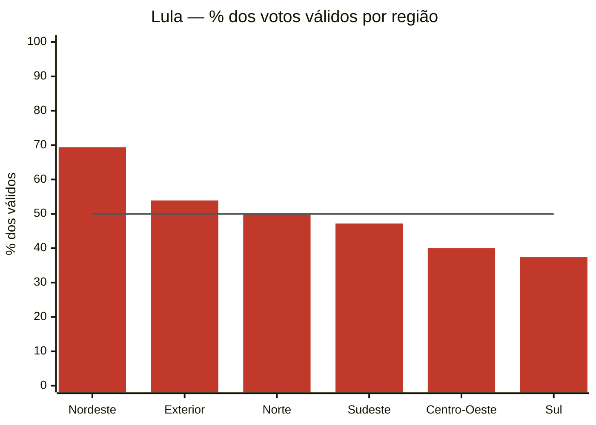

| Região | Lula | Flávio | Diferença (votos) | Comparecimento |
|---|---:|---:|---:|---:|
| Nordeste | **69,4%** | 30,6% | Lula +13.653.696 | 83,5% |
| Exterior | **53,9%** | 46,1% | Lula +28.657 | 41,6% |
| Norte | **50,01%** | 49,99% | Lula +1.079 | 78,8% |
| Sudeste | 47,2% | **52,8%** | Flávio +2.806.770 | 79,7% |
| Centro-Oeste | 40,0% | **60,0%** | Flávio +1.869.948 | 80,0% |
| Sul | 37,4% | **62,6%** | Flávio +4.576.523 | 81,8% |

Só a vantagem de Lula no Nordeste (+13,7 milhões) já supera a soma das vantagens de Flávio no Sudeste, Sul e Centro-Oeste (+9,3 milhões). O Norte terminou praticamente empatado: 1.079 votos de diferença em 10 milhões.

### Por UF

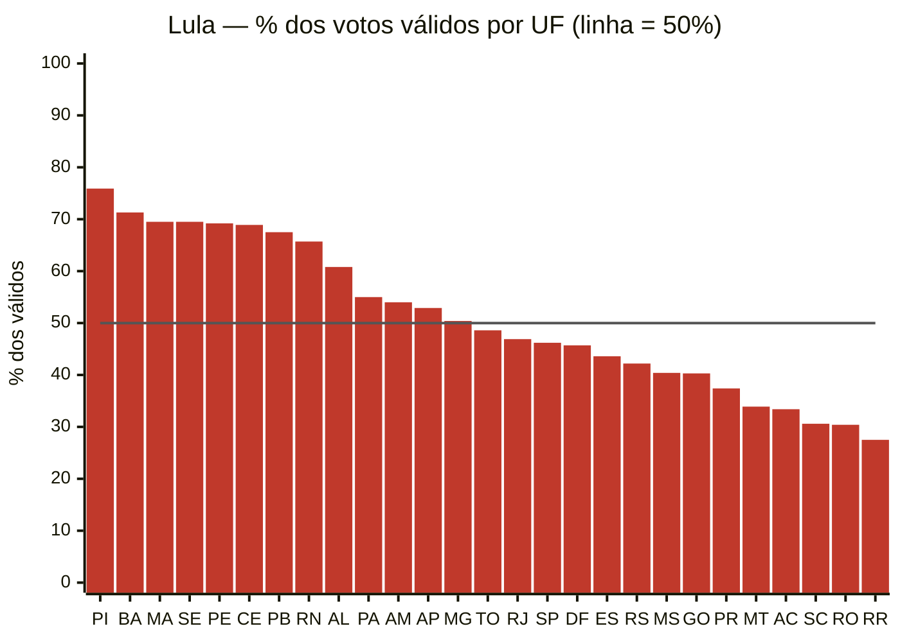

- **Lula mais forte:** PI (75,9%), BA (71,3%), MA (69,5%), SE (69,5%).
- **Flávio mais forte:** RR (72,5%), RO (69,6%), SC (69,4%), AC (66,6%).
- **Disputas apertadas:** MG (Lula 50,4%) e TO (Flávio 51,4%).

### Municípios com maior vantagem

| Lula | Vantagem | Flávio Bolsonaro | Vantagem |
|---|---:|---|---:|
| São Paulo (SP) | +766.431 | Curitiba (PR) | +277.152 |
| Salvador (BA) | +732.320 | Goiânia (GO) | +203.524 |
| Fortaleza (CE) | +312.648 | Joinville (SC) | +172.564 |
| Recife (PE) | +233.027 | Brasília (DF) | +154.318 |
| Teresina (PI) | +178.352 | | |

São Paulo deu a Lula a maior vantagem municipal do país (55,5% dos válidos), mas o estado de SP como um todo foi de Flávio (53,8%). O restante do estado pesou mais que a capital.

---

## 4. Votos entre 17h e 19h

As urnas fecham às 17h de Brasília. Depois disso, só vota quem já estava na fila.

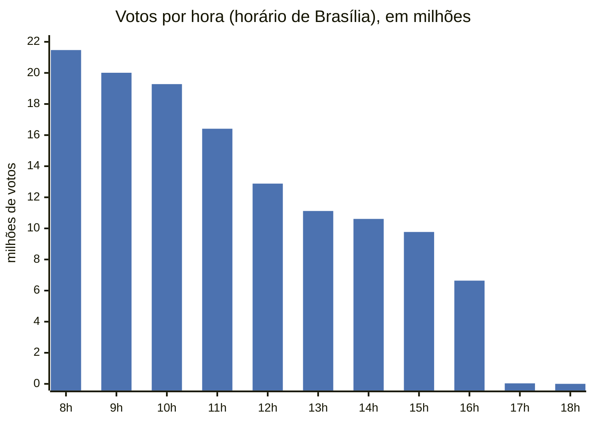

| Faixa | Votos | % do total |
|---|---:|---:|
| 8h–12h | 77.171.901 | 60,2% |
| 12h–17h | 51.028.577 | 39,8% |
| **17h–18h** | **32.754** | 0,026% |
| **18h–19h** | **1.982** | 0,002% |
| depois das 19h | 11 | — |

**A votação é concentrada de manhã.** A primeira hora (8h) foi a mais movimentada, com 21,5 milhões de votos. O fluxo cai ao longo do dia, e às 17h as filas já estavam praticamente zeradas.

### Comparação por UF

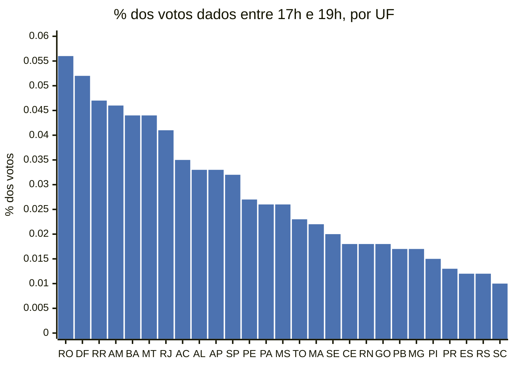

Os votos depois das 17h foram proporcionalmente mais comuns em **RO, DF, RR e AM**, cerca de 5 vezes mais que em **SC, RS e ES**. O Sul teve a menor taxa entre as regiões (0,012%). No exterior a taxa foi de 0,11%, mas ali os horários são os locais de cada país e não são comparáveis.

---

## 5. Votos sem biometria

São duas medidas:

- **Sem biometria (log):** todo eleitor que votou sem ser liberado pela própria digital. Inclui quem não tem biometria cadastrada.
- **Biometria não reconhecida (BU):** só quem **tinha** biometria cadastrada e não foi reconhecido. É um subconjunto da primeira.

| Medida | Eleitores | % dos votos |
|---|---:|---:|
| Sem biometria (log) | 16.268.923 | **12,69%** |
| Biometria não reconhecida (BU) | 8.632.488 | **6,73%** |
| Diferença (sem cadastro biométrico, exterior etc.) | ~7,6 milhões | ~5,96% |

O exterior (380.612 eleitores) não tem habilitação biométrica e responde por parte dessa diferença.

### Comparação por UF

As barras mostram o total sem biometria (log), e a linha mostra só a biometria não reconhecida (BU).

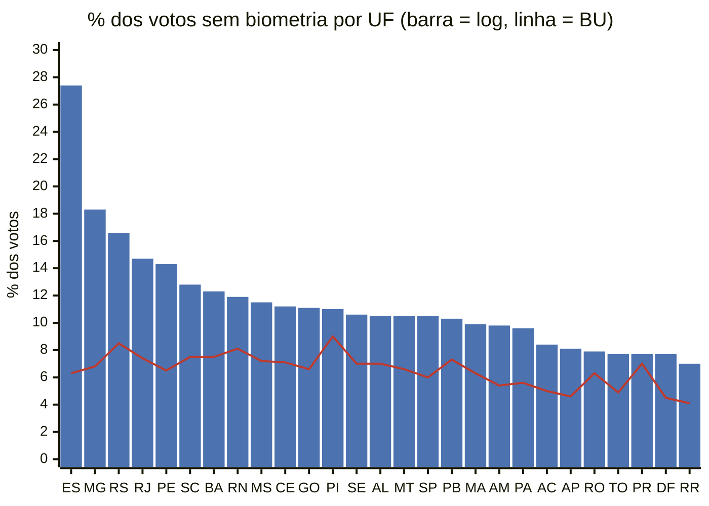

- **A falha de reconhecimento é parecida em todo o país:** a linha (BU) fica entre 4% e 9% em todas as UFs.
- **O que separa as UFs é a falta de cadastro.** O **ES** (27,4%) tem uma taxa de não reconhecimento comum (6,3%), mas mais de 20% dos votos sem nenhuma habilitação biométrica, o que aponta para cobertura incompleta do cadastro. O mesmo padrão aparece, mais fraco, em **MG** (18,3% × 6,8%) e **RS** (16,6% × 8,5%).
- **As menores taxas** estão em RR, DF, PR e TO (7–8%).

### Ao longo do dia

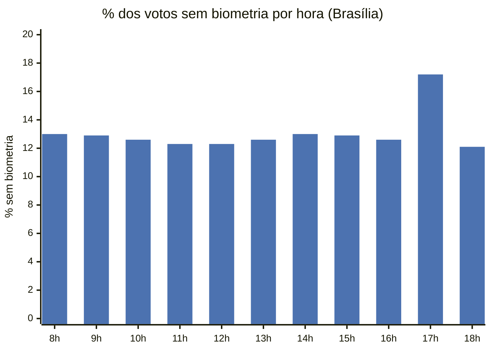

A proporção fica estável, entre 12% e 13%, de 8h às 16h. **Às 17h ela sobe para 17,2%.** Entre os eleitores da fila final, mais pessoas votaram sem biometria. Uma explicação possível, não verificada, é que mesários liberem eleitores sem a digital para agilizar o encerramento.

---

## 6. Brancos, nulos e os números digitados

### Ranking dos números digitados ao anular

Foram 2.722.696 votos nulos com número digitado, em 98 números diferentes.

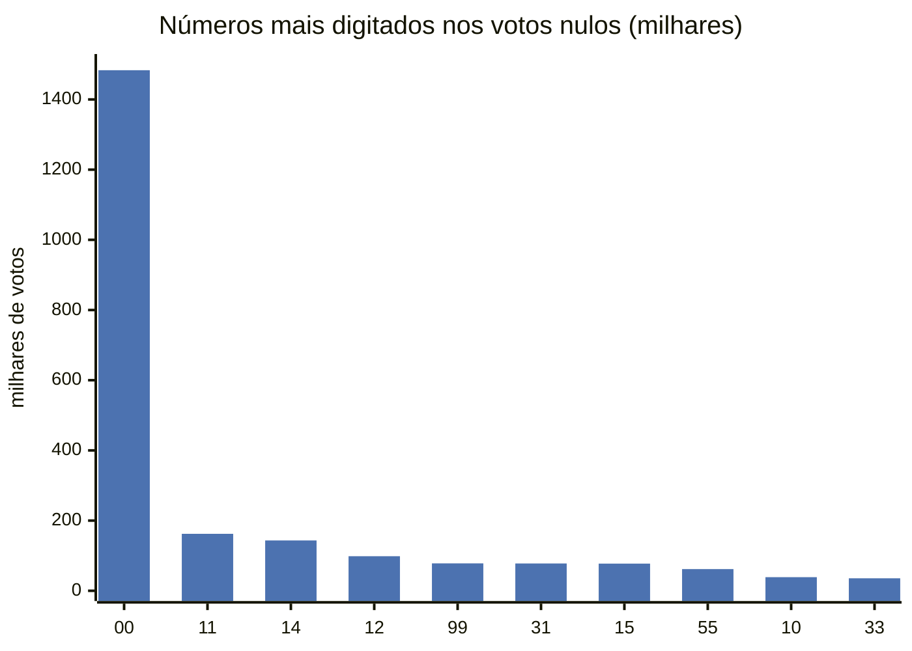

| Posição | Número | Votos | % dos nulos |
|---:|:---:|---:|---:|
| 1 | **00** | 1.483.343 | **54,48%** |
| 2 | 11 | 162.324 | 5,96% |
| 3 | 14 | 143.372 | 5,27% |
| 4 | 12 | 98.490 | 3,62% |
| 5 | 99 | 78.143 | 2,87% |
| 6 | 31 | 77.823 | 2,86% |
| 7 | 15 | 77.389 | 2,84% |
| 8 | 55 | 61.750 | 2,27% |
| 9 | 10 | 38.803 | 1,43% |
| 10 | 33 | 35.576 | 1,31% |

- **"00" é o voto nulo deliberado:** mais da metade de quem anulou digitou o número mais óbvio para anular.
- **Os seguintes parecem números de partidos** (11, 12, 14, 15, 31, 55…). Uma hipótese, não verificada, é que sejam eleitores digitando o número de candidatos ou partidos que não estavam no 2º turno.
- **"99"** também aparece como forma deliberada de anular.

### Nulos por UF

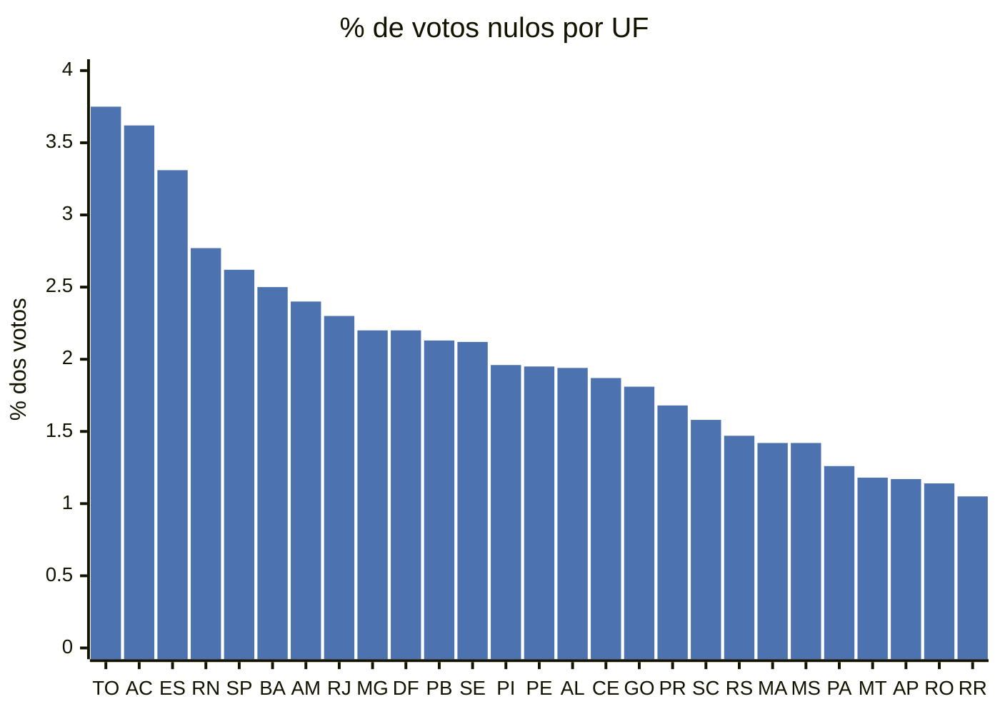

TO e AC têm mais que o triplo da taxa de nulos de RR e RO. Brancos foram mais raros que nulos em todas as UFs: entre 0,70% (RR) e 1,42% (SP).

---

## 7. Em quem votou quem votou tarde ou sem biometria?

**Não dá para contar.** O log da urna registra *quando* e *como* cada eleitor foi liberado, mas não *em quem* votou. O RDV registra cada voto, mas embaralhado, sem hora e sem eleitor. É isso que garante o sigilo do voto. A menor unidade em que voto e horário ou biometria aparecem juntos é a **seção eleitoral**, com cerca de 250 eleitores.

O que se pode fazer é **estimar** a partir das ~500 mil seções. Os dois métodos usados:

- **Perfil das seções:** como votaram as seções onde esses eleitores estavam, ponderado pelo número deles em cada seção.
- **Regressão dentro do município:** compara seções vizinhas com mais ou menos eleitores do grupo.

| Grupo | Método | Lula | Flávio | Brancos | Nulos |
|---|---|---:|---:|---:|---:|
| Todos | resultado contado | 50,1% | 46,7% | 1,1% | 2,1% |
| Sem biometria (15,9 mi) | perfil das seções | 50,5% | 46,2% | 1,1% | 2,1% |
| Sem biometria | regressão dentro do município | **52,7%** | **44,2%** | 1,1% | 2,0% |
| Depois das 17h (34 mil) | perfil das seções | 52,5% | 44,0% | 1,2% | 2,3% |
| Depois das 17h | regressão dentro do município | 159% ❌ | −72% ❌ | — | — |

- **Sem biometria:** os dois métodos são coerentes. A estimativa indica um grupo **cerca de 2 pontos mais favorável a Lula** que a média.
- **Depois das 17h:** são 0,07 eleitores por seção em média, e 94% das seções não tiveram nenhum. Com tão pouca variação, a regressão produz valores impossíveis, então **não há estimativa confiável**. O perfil das seções (52,5% Lula) descreve onde essas pessoas votaram, não em quem votaram.

### Voto em Lula conforme a proporção de eleitores sem biometria na seção

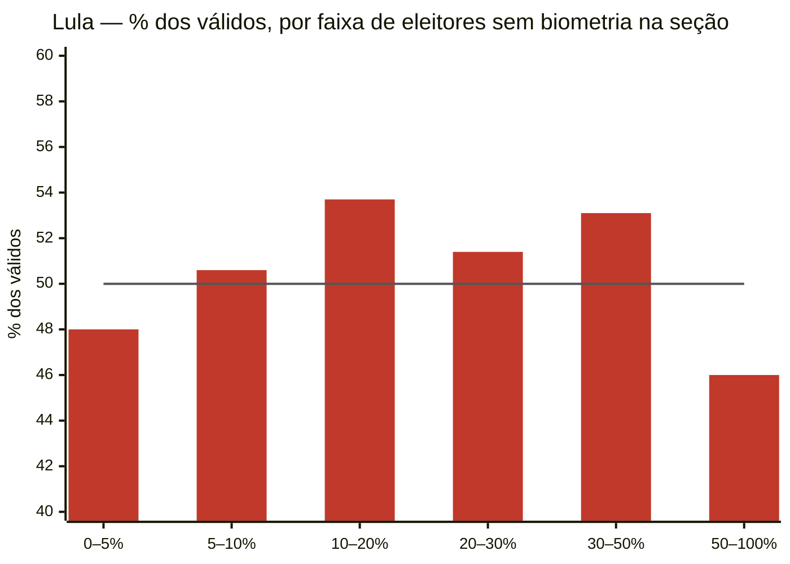

| Eleitores sem biometria na seção | Seções | Lula (% válidos) |
|---|---:|---:|
| menos de 5% | 45.364 | 48,0% |
| 5–10% | 176.538 | 50,6% |
| 10–20% | 211.164 | 53,7% |
| 20–30% | 48.303 | 51,4% |
| 30–50% | 13.524 | 53,1% |
| 50% ou mais | 2.996 | 46,0% |

A relação **não é linear**. O voto em Lula sobe das seções com menos de 5% sem biometria para as de 10–20%, mas cai de novo nas seções em que metade ou mais votou sem biometria. Isso reforça que a proporção sem biometria acompanha outras características do lugar, como região, urbanização e cobertura do cadastro. A estimativa acima deve ser lida com cautela.

---

## 8. Comparecimento

O comparecimento foi de **80,78%** dos aptos.

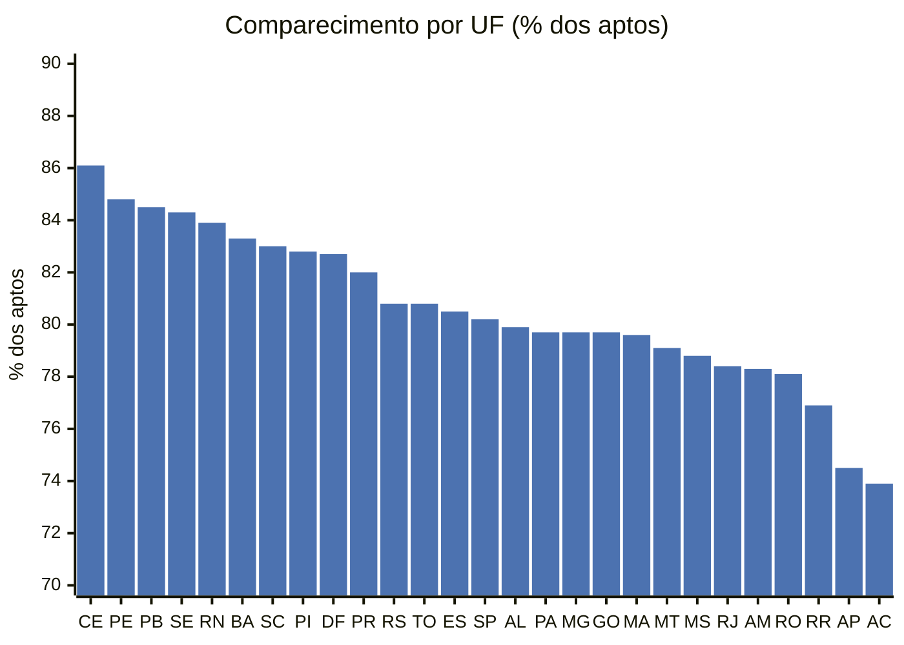

- **O Nordeste lidera:** CE (86,1%), PE, PB, SE e RN, todos acima de 83%.
- **O Norte tem os menores** índices entre as UFs: AC (73,9%) e AP (74,5%).
- **O exterior** teve comparecimento de apenas 41,6%.

---

## 9. Tabela comparativa por UF

Percentuais de brancos, nulos, votos 17h–19h e sem biometria calculados sobre o total de votos da UF.

| UF | Lula % válidos | Flávio % válidos | Comparecimento | Brancos | Nulos | Votos 17h–19h | Sem biometria (log) | Biometria não reconhecida (BU) |
|---|---:|---:|---:|---:|---:|---:|---:|---:|
| AC | 33,4% | 66,6% | 73,9% | 1,11% | 3,62% | 0,035% | 8,4% | 5,0% |
| AL | 60,8% | 39,2% | 79,9% | 0,87% | 1,94% | 0,033% | 10,5% | 7,0% |
| AM | 54,0% | 46,0% | 78,3% | 0,84% | 2,40% | 0,046% | 9,8% | 5,4% |
| AP | 52,9% | 47,1% | 74,5% | 0,77% | 1,17% | 0,033% | 8,1% | 4,6% |
| BA | 71,3% | 28,7% | 83,3% | 0,98% | 2,50% | 0,044% | 12,3% | 7,5% |
| CE | 68,9% | 31,1% | 86,1% | 0,94% | 1,87% | 0,018% | 11,2% | 7,1% |
| DF | 45,7% | 54,3% | 82,7% | 1,20% | 2,20% | 0,052% | 7,7% | 4,5% |
| ES | 43,6% | 56,4% | 80,5% | 1,37% | 3,31% | 0,012% | 27,4% | 6,3% |
| GO | 40,3% | 59,7% | 79,7% | 1,07% | 1,81% | 0,018% | 11,1% | 6,6% |
| MA | 69,5% | 30,5% | 79,6% | 0,75% | 1,42% | 0,022% | 9,9% | 6,3% |
| MG | 50,4% | 49,6% | 79,7% | 1,26% | 2,20% | 0,017% | 18,3% | 6,8% |
| MS | 40,4% | 59,6% | 78,8% | 0,94% | 1,42% | 0,026% | 11,5% | 7,2% |
| MT | 33,9% | 66,1% | 79,1% | 0,74% | 1,18% | 0,044% | 10,5% | 6,6% |
| PA | 55,0% | 45,0% | 79,7% | 0,73% | 1,26% | 0,026% | 9,6% | 5,6% |
| PB | 67,5% | 32,5% | 84,5% | 0,95% | 2,13% | 0,017% | 10,3% | 7,3% |
| PE | 69,2% | 30,8% | 84,8% | 0,93% | 1,95% | 0,027% | 14,3% | 6,5% |
| PI | 75,9% | 24,1% | 82,8% | 0,72% | 1,96% | 0,015% | 11,0% | 9,0% |
| PR | 37,4% | 62,6% | 82,0% | 1,17% | 1,68% | 0,013% | 7,7% | 7,0% |
| RJ | 46,9% | 53,1% | 78,4% | 1,11% | 2,30% | 0,041% | 14,7% | 7,4% |
| RN | 65,7% | 34,3% | 83,9% | 0,89% | 2,77% | 0,018% | 11,9% | 8,1% |
| RO | 30,4% | 69,6% | 78,1% | 0,85% | 1,14% | 0,056% | 7,9% | 6,3% |
| RR | 27,5% | 72,5% | 76,9% | 0,70% | 1,05% | 0,047% | 7,0% | 4,1% |
| RS | 42,2% | 57,8% | 80,8% | 1,30% | 1,47% | 0,012% | 16,6% | 8,5% |
| SC | 30,6% | 69,4% | 83,0% | 1,02% | 1,58% | 0,010% | 12,8% | 7,5% |
| SE | 69,5% | 30,5% | 84,3% | 0,90% | 2,12% | 0,020% | 10,6% | 7,0% |
| SP | 46,2% | 53,8% | 80,2% | 1,42% | 2,62% | 0,032% | 10,5% | 6,0% |
| TO | 48,6% | 51,4% | 80,8% | 0,84% | 3,75% | 0,023% | 7,7% | 4,9% |
| **Exterior** | 53,9% | 46,1% | 41,6% | 1,23% | 1,34% | 0,110%* | 100%** | — |
| **Brasil + exterior** | **51,8%** | **48,2%** | **80,8%** | **1,12%** | **2,12%** | **0,027%** | **12,7%** | **6,7%** |

\* Hora local de cada país. \*\* O exterior não tem habilitação biométrica.

---

## 10. Resumo

1. **Resultado:** Lula venceu com **51,79% dos válidos** (64,3 milhões de votos) contra **48,21%** de Flávio Bolsonaro (59,8 milhões), uma diferença de **4,43 milhões de votos**. Brancos e nulos somaram 3,24% e a abstenção foi de 19,22%.
2. **Geografia:** a vitória veio do **Nordeste** (69,4% para Lula, +13,7 milhões de votos). Flávio venceu no Sul, Centro-Oeste e Sudeste, e o Norte empatou. Lula venceu em 13 UFs e Flávio em 14; em municípios, foram 2.875 contra 2.695.
3. **Horário:** **60% dos votos foram dados até o meio-dia.** Só **34.736 pessoas (0,027%)** votaram depois das 17h, mais no Norte e no Centro-Oeste (RO, DF, RR, AM) e menos no Sul.
4. **Biometria:** **12,69%** votaram sem a própria digital, cerca de 1 em cada 8. Pouco mais da metade desse grupo (6,73% dos votos) tinha biometria e não foi reconhecida, taxa parecida em todas as UFs. O resto reflete a falta de cadastro biométrico, com o **ES** fora da curva (27,4%). Na fila final, depois das 17h, a proporção sem biometria sobe para 17,2%.
5. **Nulos:** **2,12%** dos votos. **"00"** responde por 54% dos nulos, e os números seguintes parecem números de partidos. TO, AC e ES lideram em proporção de nulos.
6. **Voto por grupo:** não é possível saber em quem votou quem votou tarde ou sem biometria, porque o voto é secreto. A estimativa estatística indica que quem votou sem biometria foi **~2 pontos mais favorável a Lula** que a média, com cautela. Para quem votou depois das 17h não há estimativa confiável.
7. **Confiabilidade:** brancos e nulos lidos do RDV conferem com o Boletim de Urna em **100%** das seções, e os votos do log conferem com o comparecimento em **99,993%** (28 seções sem log e 7 divergentes, 849 votos no total).

---

### Notas de leitura

- **Horários:** convertidos para Brasília a partir da hora local de cada urna. O fuso de cada município é inferido pela hora de abertura, que acontece às 8h de Brasília. A janela "17h–19h" vai de 17:00:00 a 18:59:59. O exterior usa a hora local de cada país.
- **Origem de cada número:**
  - percentuais de votos e de comparecimento: totais oficiais do TSE;
  - horários e "sem biometria (log)": logs das urnas;
  - números digitados nos nulos: RDV.
- **Data dos dados:** Boletim de Urna e arquivos de urna publicados em 26/10/2026; resultados gerados em 30/10/2026.
- **Mais detalhes:** a metodologia completa e o código estão no notebook `notebooks/analise_eleicoes_2026.ipynb` e no `README.md`.
