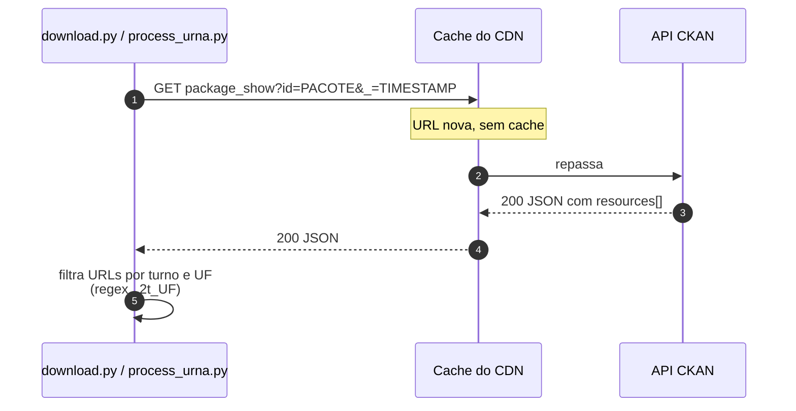
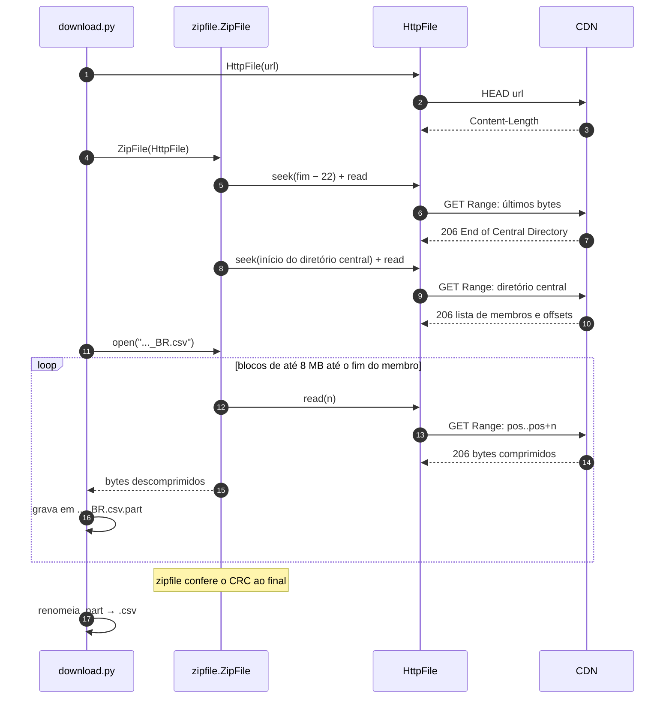
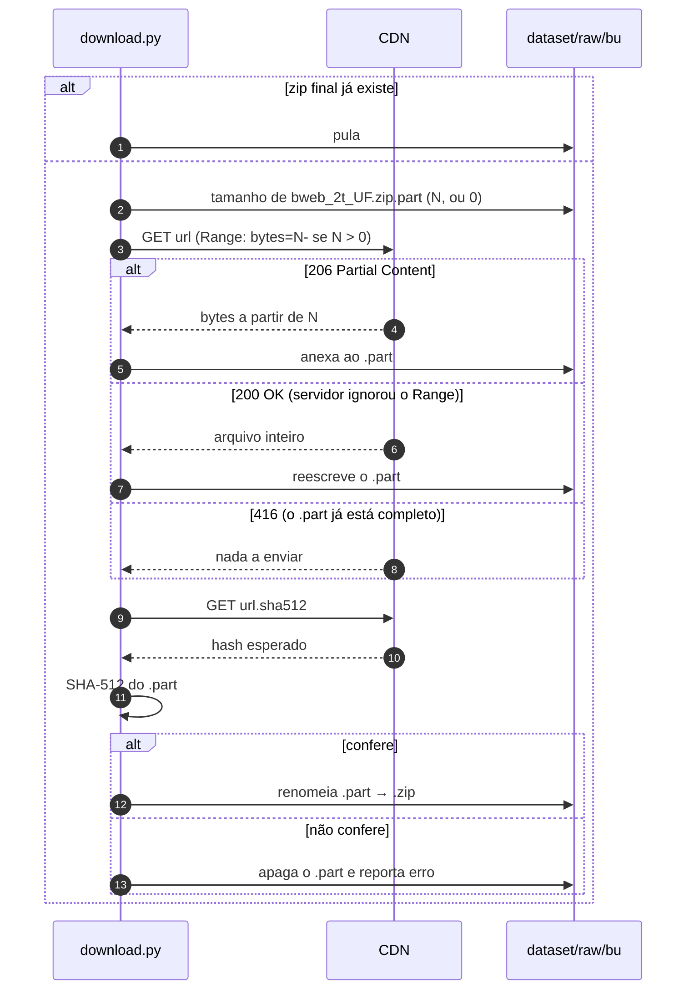
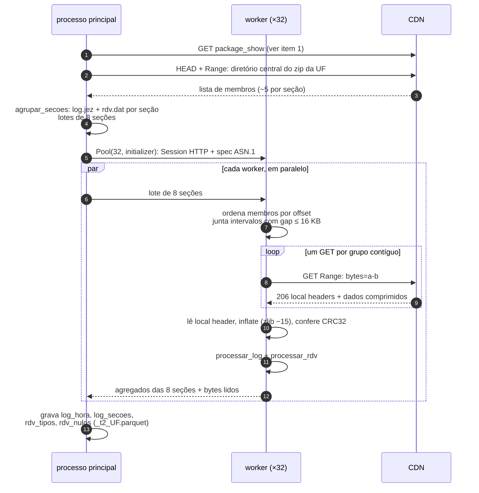
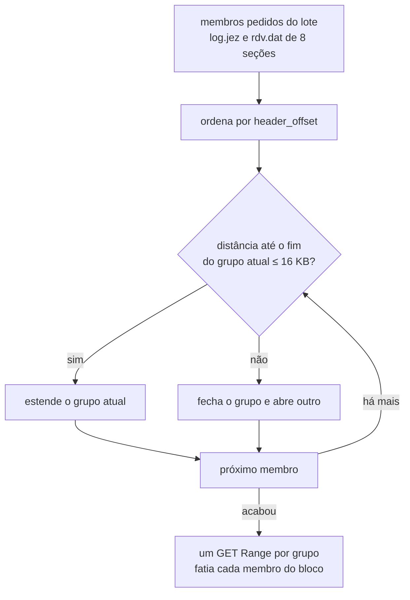

# Requisições ao TSE

Este documento descreve como os scripts conversam com o Portal de Dados Abertos do TSE. São dois serviços:

- **API CKAN** (`dadosabertos.tse.jus.br/api/3/action/package_show`): lista os arquivos de cada pacote.
- **CDN** (`cdn.tse.jus.br/estatistica/sead/eleicoes/eleicoes2026/...`): serve os arquivos e aceita requisições parciais (`Range: bytes=a-b`, resposta `206 Partial Content`).

Veja também a [arquitetura](arquitetura.md) e o [fluxo dos dados](fluxo-de-dados.md).

## 1. Listar arquivos de um pacote

A API fica atrás de um CDN que guarda as respostas por até 1 h (`cache-control: max-age=3600`). Sem cuidado, ela devolve uma versão antiga do pacote, sem os arquivos publicados depois. Foi assim que o BU do 2º turno "sumiu" na primeira tentativa. O parâmetro `_=<timestamp>`, que a API ignora, muda a URL e força uma resposta atualizada.

## 2. Extrair um CSV de dentro de um zip remoto (resultados)

O `votacao_candidato_munzona_2026.zip` tem 399 MB, mas só o membro `_BR.csv` (38 MB) interessa. O `zipfile` da biblioteca padrão recebe um `HttpFile`, um objeto "arquivo" que transforma cada `seek` + `read` em uma requisição Range.

## 3. Baixar o Boletim de Urna (download retomável)

Os zips do BU são baixados inteiros, porque o CSV inteiro é necessário. O download é retomável e conferido com o `.sha512` publicado pelo TSE.

## 4. Leitura seletiva dos arquivos de urna (`process_urna.py`)

Esse é o passo pesado: 28 zips, 124 GB, ~500 mil seções. Para cada UF:

1. ler o índice do zip remoto, como no item 2;
2. dividir as seções em lotes de 8, na ordem física do zip;
3. distribuir os lotes para 32 processos, cada um com sua própria `Session` HTTP.

### Como uma requisição cobre vários arquivos

Dentro do zip, os membros de uma seção (`bu.dat`, `rdv.dat`, `vota.vsc`, `log.jez`, imagem do BU) ficam próximos, mas a ordem entre eles varia de seção para seção. O `ler_membros` faz assim:

1. ordena os membros pedidos pelo offset;
2. calcula o intervalo de cada um: local header (30 bytes), nome, até 1 KB de campo extra e os dados comprimidos;
3. junta intervalos separados por até 16 KB.

Os bytes do meio, de membros que não interessam, só são transferidos quando o intervalo é pequeno. Um membro grande no meio, como a assinatura `vota.vsc`, separa os pedidos em duas requisições.

Se o campo extra do local header passar de 1 KB, uma segunda requisição busca só os dados daquele membro.

## Tratamento de falhas

| Situação | Tratamento |
|---|---|
| 429 ou 5xx do CDN, falha de conexão | `urllib3.Retry`: até 8 tentativas com backoff exponencial (fator 1 s), em `GET` e `HEAD` |
| Resposta sem `206` ou com tamanho diferente do pedido | `IOError`. A seção é marcada com erro em `log_secoes.erro`. |
| CRC diferente após descompressão | `IOError`, mesmo tratamento |
| Erro em um lote | só as seções do lote são marcadas, e a UF segue |
| Interrupção do `process_urna.py` | retoma: UFs com os 4 Parquets prontos são puladas |
| Interrupção do download do BU | retoma pelo `.part` com `Range: bytes=N-` |
| Falha de um zip do BU | os demais seguem, e a saída lista as falhas com código diferente de zero |
| Lista de arquivos desatualizada | parâmetro anti-cache `_` na API CKAN |

## Volume e tempo (2º turno, medidos)

| Etapa | Requisições | Bytes transferidos | Tempo |
|---|---|---|---|
| Resultados (`_BR.csv`) | poucas dezenas | ~42 MB | ~1 min |
| BU (27 zips) | 54 (zip + `.sha512`) | 0,14 GB | alguns minutos |
| Arquivos de urna (28 UFs) | da ordem de 1 a 2 GETs por seção, mais o índice de cada UF | ~89 GB | ~30–45 min com 50–76 MB/s |
